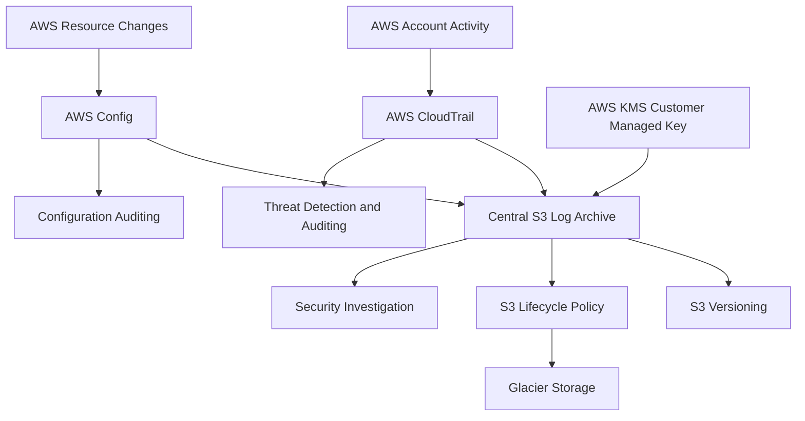

# AWS Threat Detection, Monitoring, Incident Response & Forensics

## 1. Project Overview

This project implements a centralized AWS security logging and monitoring architecture to support threat detection, security investigations, incident response, and forensic analysis.

The architecture uses AWS CloudTrail, AWS Config, Amazon S3, and AWS KMS to collect, protect, and retain security-related logs and configuration history.

## 2. Architecture Components

### Amazon S3 – Central Log Archive
- Stores CloudTrail logs and AWS Config configuration history.
- Blocks all public access.
- Uses server-side encryption with AWS KMS.
- Enables bucket versioning.
- Applies lifecycle policies to transition older logs to Glacier after 90 days.
- Configures log retention policies.

### AWS CloudTrail
- Records AWS account activity.
- Enables multi-region logging.
- Includes global service events.
- Enables log file validation.
- Delivers logs to the centralized S3 bucket.
- Supports management events and optional data events.

### AWS KMS
- Encrypts stored security logs.
- Uses a customer-managed KMS key.
- Enables automatic key rotation.
- Restricts key usage through resource policies.

### AWS Config
- Records supported AWS resource configuration changes.
- Uses a dedicated IAM service role.
- Delivers configuration history and snapshots to the central S3 bucket.
- Supports security auditing and compliance monitoring.

## 3. Architecture Flow

## 4. Security Controls

The architecture implements the following security controls:

- S3 Block Public Access.
- S3 Bucket Versioning.
- AWS KMS encryption.
- CloudTrail Log File Validation.
- Multi-region CloudTrail logging.
- IAM least-privilege permissions.
- Centralized log storage.
- Lifecycle-based log retention.

## 5. Log Retention Strategy

| Storage Stage | Retention |
|---|---|
| S3 Standard | First 90 days |
| Glacier | After 90 days |
| Target retention | Up to 12 months |

The exact expiration behavior is controlled by the configured S3 lifecycle rules.

## 6. Infrastructure as Code

Terraform is used to provision and manage the infrastructure.

The Terraform configuration includes:
- S3 log archive bucket.
- S3 security configurations.
- KMS encryption key.
- KMS key alias.
- CloudTrail trail.
- AWS Config recorder.
- AWS Config delivery channel.
- Required IAM permissions and policies.

## 7. Expected Benefits

- Centralized security log collection.
- Improved visibility into AWS account activity.
- Protected and encrypted audit records.
- Support for incident investigation and forensic analysis.
- Better security auditing and compliance monitoring.
- Repeatable infrastructure deployment using Terraform.